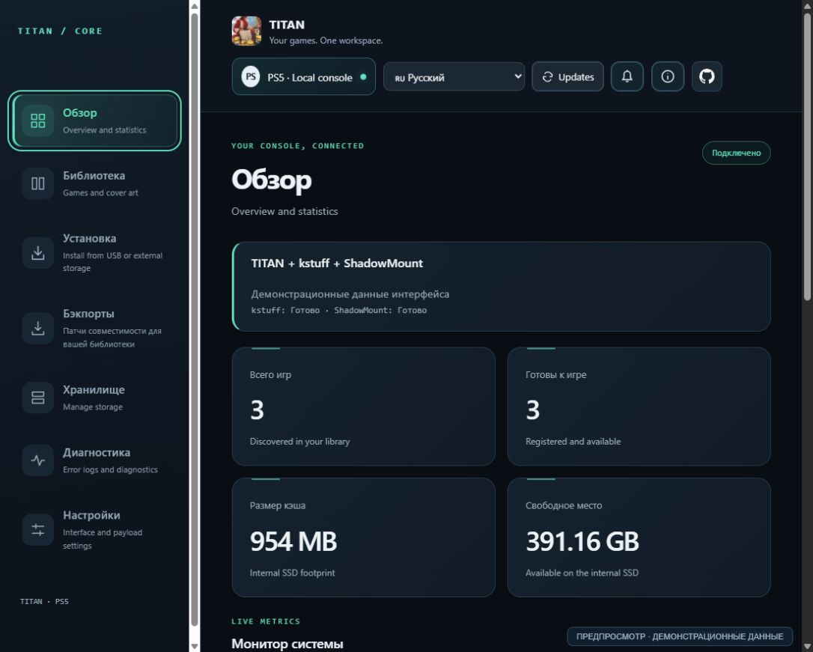
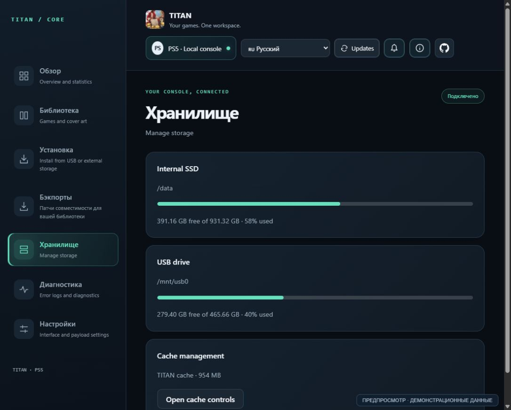
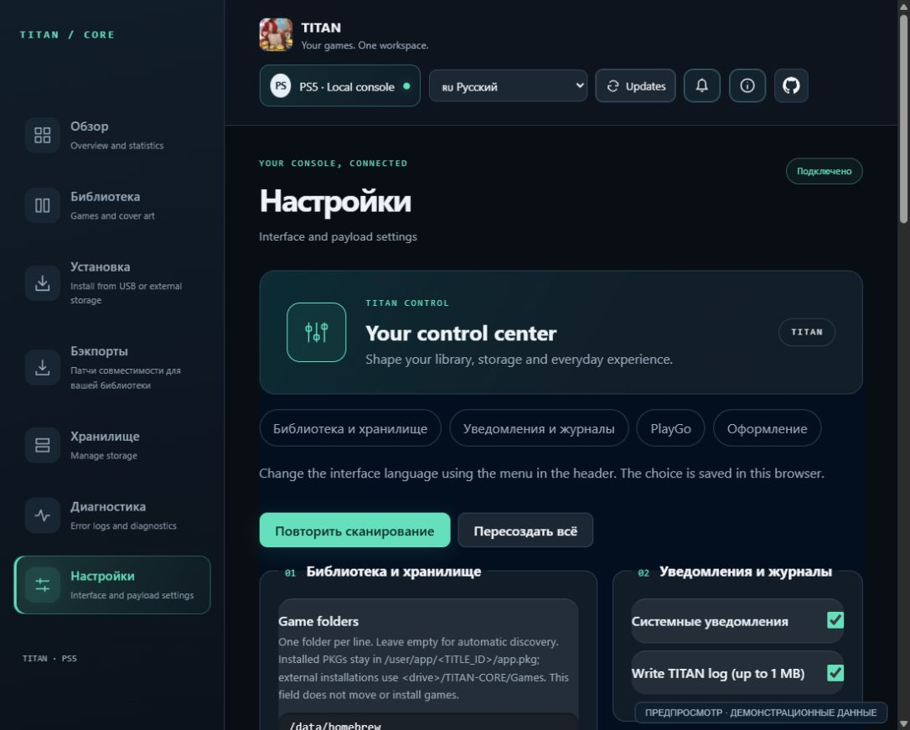

# 🛡️ TITAN | PS5 Homebrew Manager

**Русский** · [English](README_EN.md)

### PLAY NO LIMIT
**by SirenaGoloviy**

### ❤️ Поддержать проект

donate: 2200700949917206 💳

**TITAN** — многофункциональная система управления играми для модифицированных PlayStation 5. Объединяет библиотеку игр, установку совместимых PKG, настройку PlayGo, управление бэкпортами и обновление самого TITAN в едином веб-интерфейсе.

**Создан для удобного управления играми без необходимости постоянно переключаться между отдельными инструментами.**

### 🚀 Основные возможности

- 🎮 **Библиотека игр**: поиск и управление поддерживаемыми играми на внутренних и внешних накопителях.
- 📦 **PKG Manager**: установка совместимых PS5 debug/plaintext PKG с отслеживанием процесса.
- ⚡ **PlayGo Integration**: автоматическое подключение совместимой библиотеки PlayGo и индивидуальные настройки для каждой игры.
- 🛠️ **Backport Manager**: поиск, загрузка и управление бэкпортами через совместимые каталоги.
- 🔄 **Smart Updater**: обновление, переустановка и откат на выбранную версию TITAN.
- 💾 **Storage Manager**: управление хранилищем, внешними накопителями и безопасным извлечением USB.
- 🌐 **Web Dashboard**: управление через браузер компьютера или телефона в локальной сети.
- 🔍 **Diagnostics**: системная диагностика и журналы ошибок.

### 📥 Скачать TITAN

**Стабильная версия: FIX10 (1.0.8)**

[⬇️ Скачать TITAN FIX10](https://github.com/grimmtroll2285-dot/TITAN/releases/download/fix10/TITAN-SirenaGoloviy-fix10.elf)

**Тестовая версия: FIX9 pre1**

[🧪 Скачать предварительную сборку](https://github.com/grimmtroll2285-dot/TITAN/releases/tag/fix9-pre1)

### Что нового в FIX10

Встроены **Kraken Mount 0.3.1** и **AMPR 0.5.0**: пакетная регистрация на FW 12+, копирование метаданных блоками 1 МиБ, поиск на уровень папок глубже и переключатель PlayGo в карточке игры. Обновлятор, бэкпорты, именные галочки PlayGo и защиты сохранены.

Внешние архивы PKG размещайте только в **homebrew** в корне диска и её подпапках. Перед обновлением закройте игры и полностью перезагрузите консоль; дождитесь Ready перед запуском игры.

**128 тестов на ПК прошли. На реальной PS5 FIX10 ещё не проверен; ускорение и исправления конкретных игр не подтверждены для этой сборки.**

[Все файлы FIX10, исходники и результаты проверок](https://github.com/grimmtroll2285-dot/TITAN/releases/tag/fix10)

### ⚙️ Совместимость и требования

- Основная целевая прошивка: **PS5 13.60**
- Требуется работающий jailbreak и ELF Loader
- Управление через браузер: `http://IP_PS5:8097`
- Поддержка игр и форматов зависит от возможностей встроенных компонентов и прошивки

**Важно:** TITAN не гарантирует запуск всех игр, не заменяет необходимые бэкпорты и не поддерживает произвольные зашифрованные retail PKG.

### 📸 Скриншоты интерфейса

Предпросмотр FIX10 с демонстрационными данными. Нажмите на снимок, чтобы открыть его в полном размере. Это снимки интерфейса, а не результаты проверки игр или производительности на PS5.

| Обзор | Библиотека |
|:--:|:--:|
|  |  |
| **Установка PKG** | **Бэкпорты** |
|  |  |
| **Хранилище** | **Диагностика** |
|  |  |
| **Настройки** | **Обновления** |
|  |  |

### 📚 Документация

[Установка](INSTALL_RU.md) · [Бэкпорты](BACKPORTS.md) · [История изменений](CHANGELOG_RU.md) · [Авторы и лицензии](CREDITS.md)

### 🙏 Спасибо тестерам

Спасибо **@ImN3k1t** и **Владимиру Барсуку (@script_durova)** за тестирование на PS5, отчёты об ошибках и помощь в развитии TITAN.

---

**TITAN | PLAY NO LIMIT**

Developed by **SirenaGoloviy**.

Built on open-source technologies and contributions from the PS5 homebrew community.

