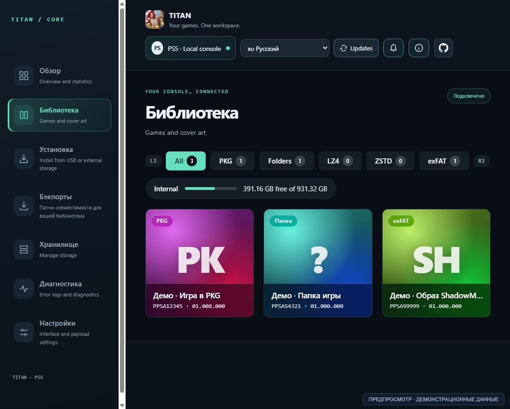
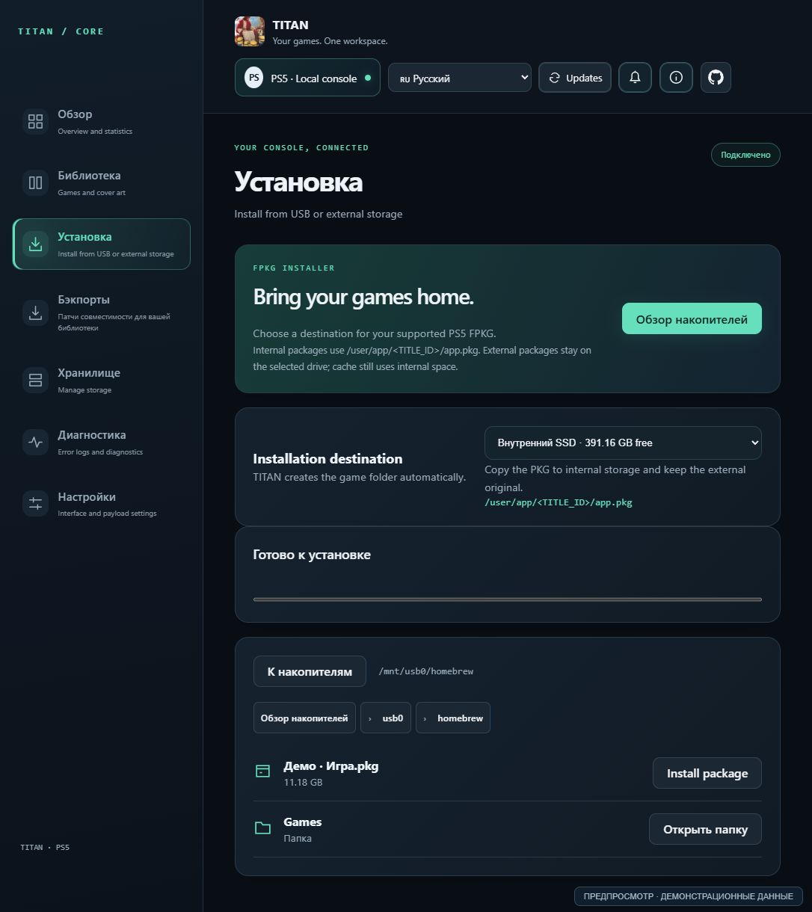
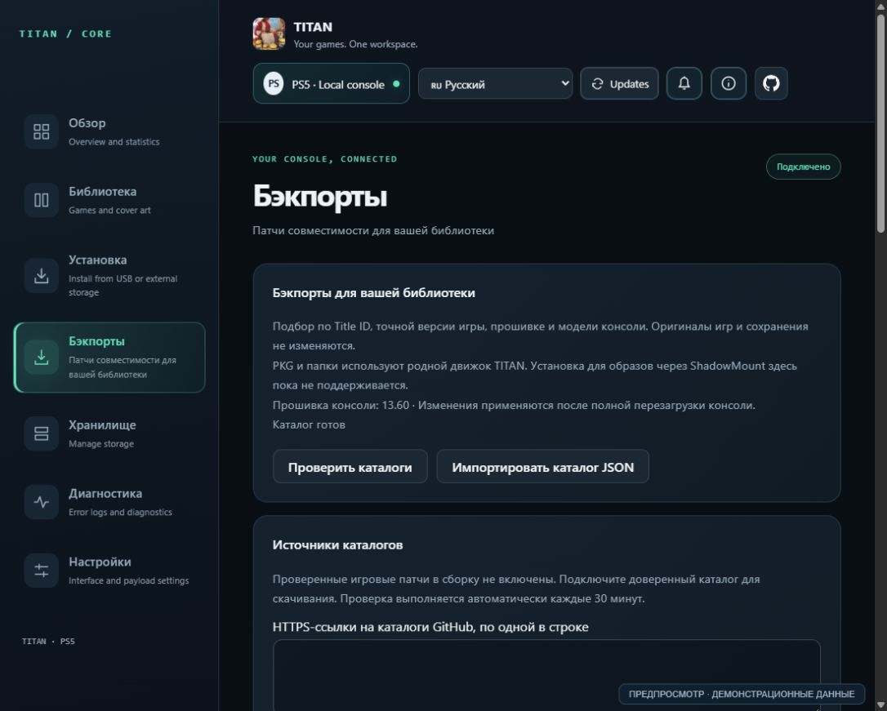
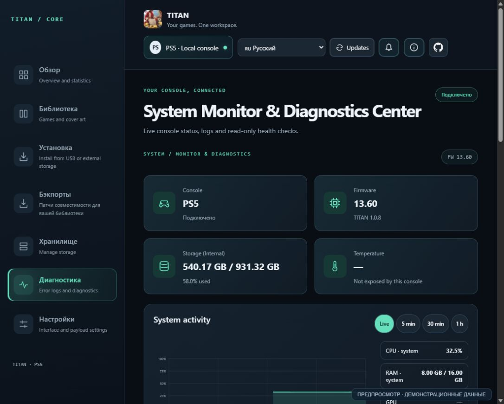
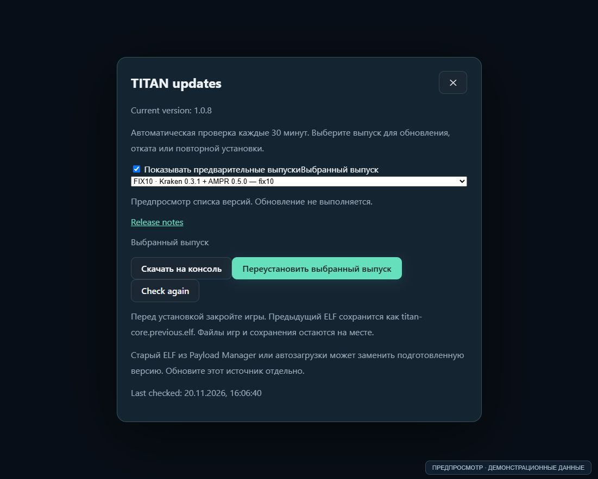

# 🛡️ TITAN | PS5 Homebrew Manager

**Русский** · [English](README_EN.md)

### PLAY NO LIMIT
**by SirenaGoloviy**

### ❤️ Поддержать проект

donate: 2200700949917206 💳

**TITAN** — многофункциональная система управления играми для модифицированных PlayStation 5. Объединяет библиотеку игр, установку совместимых PKG, настройку PlayGo, управление бэкпортами и обновление самого TITAN в едином веб-интерфейсе.

**Создан для удобного управления играми без необходимости постоянно переключаться между отдельными инструментами.**

### 🚀 Основные возможности

- 🎮 **Библиотека игр**: поиск и управление поддерживаемыми играми на внутренних и внешних накопителях.
- 📦 **PKG Manager**: установка совместимых PS5 debug/plaintext PKG с отслеживанием процесса.
- ⚡ **PlayGo Integration**: автоматическое подключение совместимой библиотеки PlayGo и индивидуальные настройки для каждой игры.
- 🛠️ **Backport Manager**: поиск, загрузка и управление бэкпортами через совместимые каталоги.
- 🔄 **Smart Updater**: обновление, переустановка и откат на выбранную версию TITAN.
- 💾 **Storage Manager**: управление хранилищем, внешними накопителями и безопасным извлечением USB.
- 🌐 **Web Dashboard**: управление через браузер компьютера или телефона в локальной сети.
- 🔍 **Diagnostics**: системная диагностика и журналы ошибок.

### 📥 Скачать TITAN

**Стабильная версия: FIX12 (1.0.10)**

[⬇️ Скачать TITAN FIX12](https://github.com/grimmtroll2285-dot/TITAN/releases/download/fix12/TITAN-SirenaGoloviy-fix12.elf)

### Что нового в FIX12

- **Kraken Mount 0.3.2 и официальный AMPR 0.5.1.** Обновлены нативный движок и модуль чтения упакованных игр.
- **Закрытие и переход между ELF игры:** собственные монтирования в песочнице снимаются сразу после выхода, библиотечный overlay кратко сохраняется для перехода к следующему ELF той же игры. Занятые и чужие монтирования принудительно не снимаются.
- **Исправления AMPR от upstream:** сохранения в PKG, зависание Hades при закрытии, чтение каталогов в DIRT 5, MARVEL Cosmic Invasion и Scott Pilgrim EX. Работа конкретных игр в TITAN требует проверки на PS5; исправление сохранений Wolverine ещё не подтверждено автору отчёта.
- **Защита от второго экземпляра:** блокировка процесса отдельно от HTTP-порта не позволяет двум FIX12 одновременно пересобирать один кэш после режима покоя. Для перехода с FIX11 нужна полная перезагрузка.
- **Библиотека:** поиск по названию, Title ID и пути; фильтр по накопителю; кнопка «Играть» для готовых нативных игр.
- **Диагностика:** сохранение последнего обнаруженного сбоя и текстовый отчёт из карточки игры. Полный дамп ядра не скачивается автоматически.
- **Настройки:** исключение файлов и папок из нативного сканирования; отключение библиотечного overlay отдельно для игры в папке. Для PKG обязательный AMPR сохраняется.
- **Playden:** подмножество API v1 нативной библиотеки на порту 8097: список, сканирование, исключения, снятие собственной регистрации без удаления исходника и переключение overlay.
- **FW 12+:** восстановление плитки TITAN через пакетную регистрацию и повторное открытие веб-порта после выхода из режима покоя.

Сохранены обновлятор TITAN с выбором версии и откатом, PlayGo 0.6 с выбором игр, бэкпорты, автоудаление только собственных пропавших плиток, защита YouTube и сторонних монтирований. Внешние архивы PKG сканируются только в `<диск>/homebrew/` и её подпапках. Файлы установленных системных PKG остаются на своих местах.

**FIX12 — стабильный выпуск (1.0.10), не pre-release.** Статус релиза не означает подтверждённую совместимость всех игр. Известный вылет Forza Horizon 5 в PKG не подтверждён как исправленный. Аппаратные испытания FIX12 и замеры производительности на PS5 не выполнялись. [Проверки](VALIDATION.md) · [Подробности интеграции](KRAKEN_0_3_2_UPGRADE.md) · [История](CHANGELOG_RU.md).

### ⚙️ Совместимость и требования

- Основная целевая прошивка: **PS5 13.60**
- Требуется работающий jailbreak и ELF Loader
- Управление через браузер: `http://IP_PS5:8097`
- Поддержка игр и форматов зависит от возможностей встроенных компонентов и прошивки

**Важно:** TITAN не гарантирует запуск всех игр, не заменяет необходимые бэкпорты и не поддерживает произвольные зашифрованные retail PKG.

### Установка и начало работы

1. Скачайте **TITAN-SirenaGoloviy-fix12.elf** из [релиза FIX12](https://github.com/grimmtroll2285-dot/TITAN/releases/tag/fix12). При ручной установке используйте внешний ELF, а не stage1 или автоматически созданный GitHub Source code.
2. Закройте игры и полностью перезагрузите PS5. Выполните свой jailbreak и запустите ELF через совместимый Payload Manager либо ELF Loader. Старые копии в автозагрузке также замените на FIX12.
3. Откройте плитку TITAN или `http://IP_PS5:8097` с телефона/ПК в той же сети. Дождитесь готовности служб и статуса **Ready / Готово** у игры.
4. Для внешних архивов PKG используйте `/mnt/usb0/homebrew/Игра.pkg` или подпапки `homebrew` в корне нужного диска. Внутренние исходники можно хранить в `/data/homebrew`. Системные установленные PKG вручную не переносите.
5. В библиотеке откройте карточку и нажмите «Играть» либо запустите зарегистрированную игру из меню PS5. Поиск и фильтр диска расположены над карточками.

**PlayGo:** «Настройки → PlayGo — выбор игр»; отметьте нужные игры и сохраните. **Overlay:** переключатель в карточке нативной игры в папке; для PKG недоступен. **Отчёт:** ссылка «Отчёт об игре» в карточке. **Обновления:** выберите нужный стабильный выпуск или pre-release; доступны обновление, переустановка и откат. После установки полностью перезапустите консоль.

При первом запуске FIX12 старые кэши обновляются для нового расположения дополнительных ELF. Дождитесь Ready. Файлы игры, записанные в кэш и не перечисленные как созданные TITAN, сохраняются. Полную инструкцию смотрите в [INSTALL_RU.md](INSTALL_RU.md).

### 📸 Скриншоты интерфейса

Предпросмотр FIX10 с демонстрационными данными. Нажмите на снимок, чтобы открыть его в полном размере. Это снимки интерфейса, а не результаты проверки игр или производительности на PS5.

| Обзор | Библиотека |
|:--:|:--:|
|  |  |
| **Установка PKG** | **Бэкпорты** |
|  |  |
| **Хранилище** | **Диагностика** |
|  |  |
| **Настройки** | **Обновления** |
|  |  |

### 📚 Документация

[Установка](INSTALL_RU.md) · [Бэкпорты](BACKPORTS.md) · [История изменений](CHANGELOG_RU.md) · [Авторы и лицензии](CREDITS.md)

### 🙏 Спасибо тестерам

Спасибо **@ImN3k1t** и **Владимиру Барсуку (@script_durova)** за тестирование на PS5, отчёты об ошибках и помощь в развитии TITAN.

---

**TITAN | PLAY NO LIMIT**

Developed by **SirenaGoloviy**.

Built on open-source technologies and contributions from the PS5 homebrew community.
