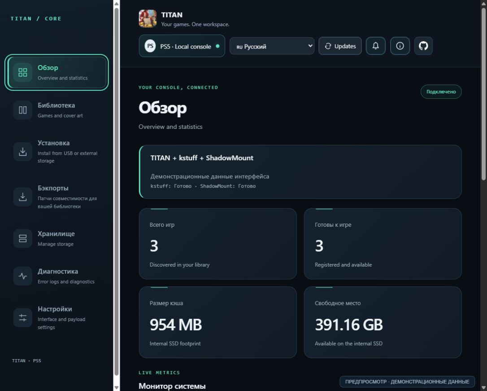
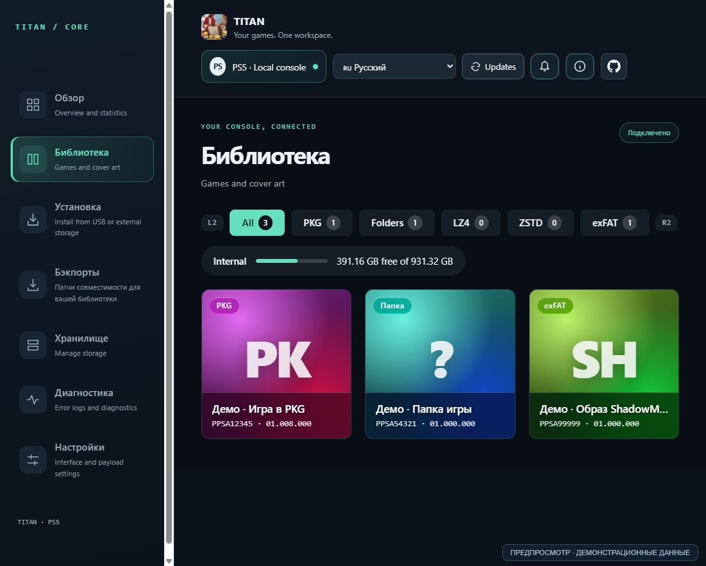
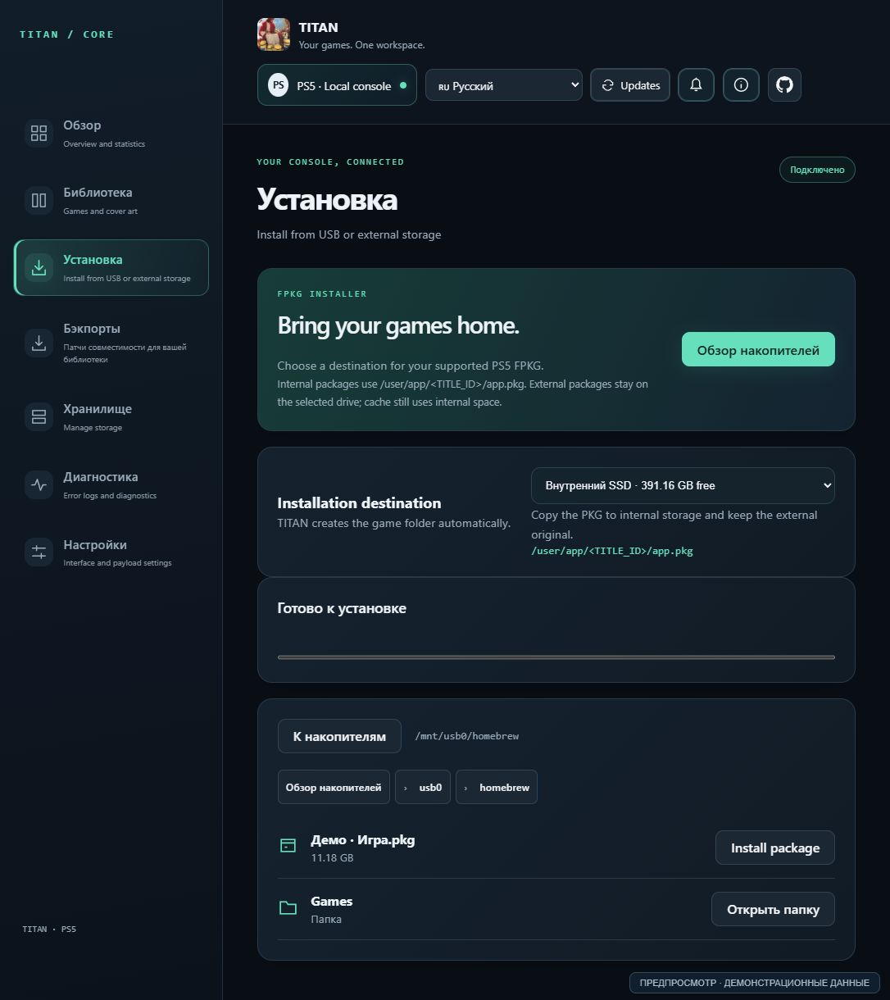
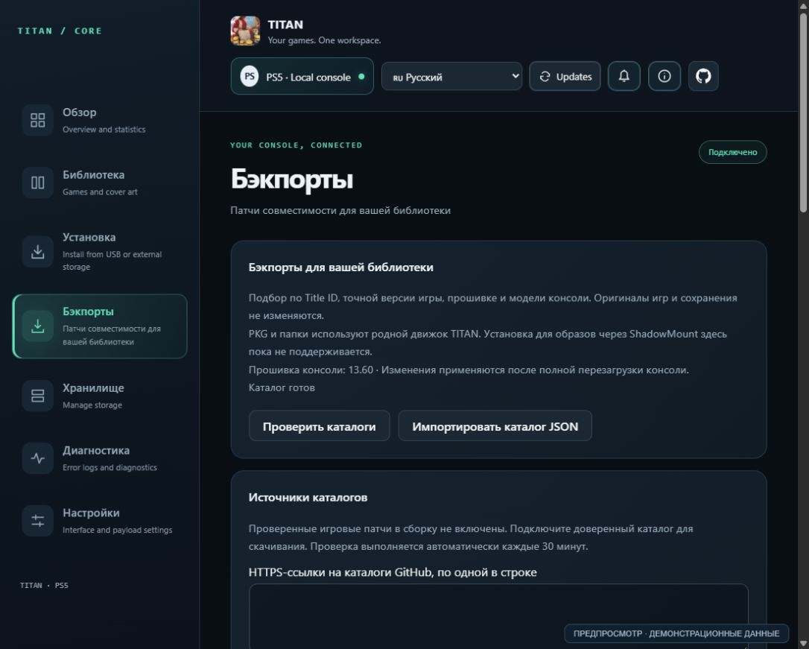
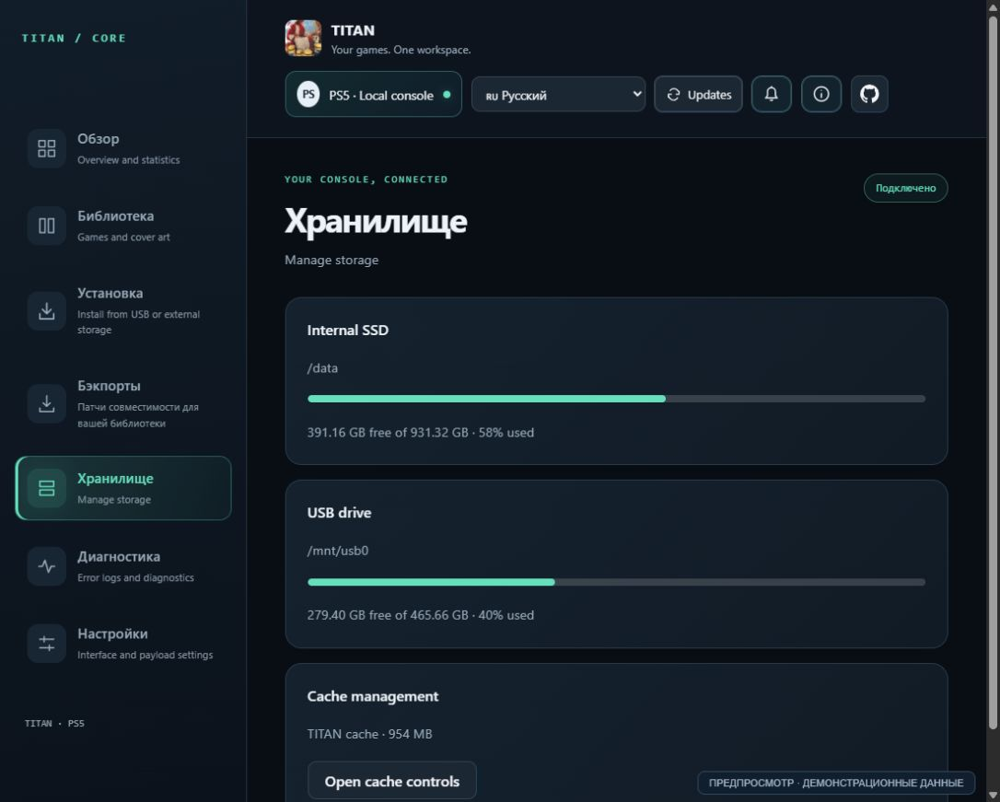
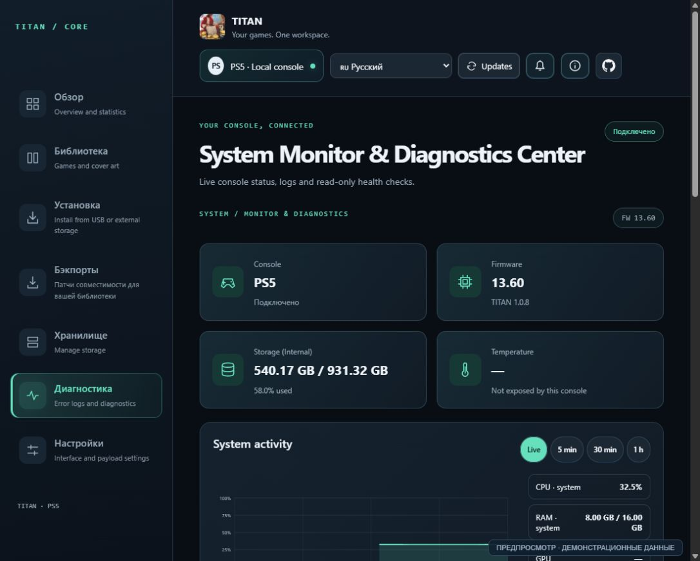
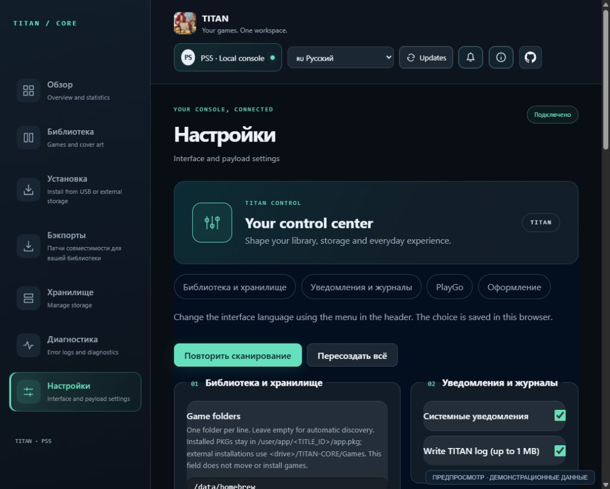
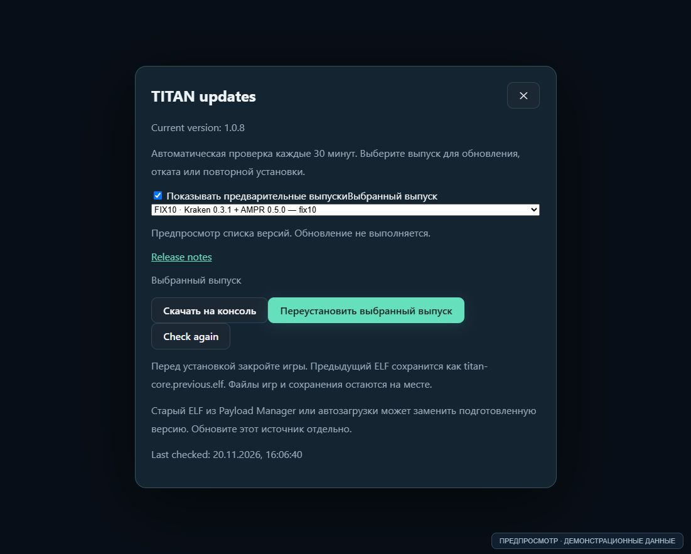

# 🛡️ TITAN | PS5 Homebrew Manager

[Русский](README.md) · **English**

### PLAY NO LIMIT
**by SirenaGoloviy**

### ❤️ Support the project

donate: 2200700949917206 💳

**TITAN** is a game management system for modified PlayStation 5 consoles. It brings together your game library, compatible PKG installation, PlayGo settings, backport management, and TITAN updates in one web interface.

**Manage your games without constantly switching between separate tools.**

### 🚀 Features

- 🎮 **Game Library**: find and manage supported games on internal and external drives.
- 📦 **PKG Manager**: install compatible PS5 debug/plaintext PKGs with progress tracking.
- ⚡ **PlayGo Integration**: automatically load a compatible PlayGo library and configure it for individual games.
- 🛠️ **Backport Manager**: find, download, and manage backports through compatible catalogs.
- 🔄 **Smart Updater**: update, reinstall, or downgrade to a selected TITAN version.
- 💾 **Storage Manager**: manage storage and external drives, with safe USB ejection.
- 🌐 **Web Dashboard**: control TITAN from a computer or phone browser on your local network.
- 🔍 **Diagnostics**: system diagnostics and error logs.

### 📥 Download TITAN

**Stable release: FIX12 (1.0.10)**

[⬇️ Download TITAN FIX12](https://github.com/grimmtroll2285-dot/TITAN/releases/download/fix12/TITAN-SirenaGoloviy-fix12.elf)

### What's new in FIX12

- **Kraken Mount 0.3.2 and official AMPR 0.5.1:** updated native engine and packed-game runtime.
- **Game exit and ELF transitions:** remove owned sandbox mounts promptly on exit and briefly retain the library overlay for another ELF of the same title. Busy or foreign mounts are never force-unmounted.
- **Upstream AMPR fixes:** PKG save handling, Hades exit hang, directory reads in DIRT 5, MARVEL Cosmic Invasion and Scott Pilgrim EX. These games still need confirmation in TITAN; the Wolverine save fix remains unconfirmed by its reporter.
- **Single-instance lifetime lock:** independent of the HTTP socket; prevents two FIX12 processes rebuilding the same cache after rest mode. Fully reboot when migrating from FIX11.
- **Library:** search by title, Title ID or path, drive filter and Play button for ready native games.
- **Diagnostics:** last detected crash and a text report in game details. Full core dumps are not downloaded automatically.
- **Settings:** exclude source files/folders from native discovery and disable the library overlay for an individual folder game. PKGs retain their required AMPR reader.
- **Playden:** native-library API v1 subset on port 8097: list, scan, exclusions, unregister owned titles while keeping sources, and overlay control.
- **FW 12+:** recover the TITAN launcher tile with batch registration; rebind the web port after rest mode.

TITAN release selection, updates/downgrades, PlayGo 0.6 game selection, backports, guarded missing-tile cleanup, YouTube protection and foreign-mount protections remain. External archive PKGs are discovered only under `<drive>/homebrew/`. Installed system PKGs stay at their original paths.

**FIX12 is a stable release (1.0.10), not a pre-release.** Release status does not certify every game. The reported Forza Horizon 5 PKG crash is not confirmed fixed. No PS5 hardware tests or performance benchmarks were performed for FIX12. [Validation](VALIDATION.md) · [Integration details](KRAKEN_0_3_2_UPGRADE.md) · [History](CHANGELOG_RU.md).

### ⚙️ Compatibility and requirements

- Primary target firmware: **PS5 13.60**
- A working jailbreak and ELF Loader are required
- Browser interface: `http://PS5_IP:8097`
- Game and format support depends on the bundled components and console firmware

**Important:** TITAN does not guarantee that every game will run, does not replace required backports, and does not support arbitrary encrypted retail PKGs.

### Install and use

1. Download **TITAN-SirenaGoloviy-fix12.elf** from the [FIX12 release](https://github.com/grimmtroll2285-dot/TITAN/releases/tag/fix12). Use the outer ELF, not stage1 or GitHub's automatic Source code archive.
2. Close games, fully reboot the console, run your jailbreak and load the ELF through a compatible Payload Manager or ELF Loader. Replace older autoload copies too.
3. Open the TITAN tile or `http://PS5_IP:8097` from a computer/phone on the same network. Wait for services and the game's **Ready** status.
4. Put external archive PKGs in the drive-root `homebrew` folder, e.g. `/mnt/usb0/homebrew/Game.pkg`, including subfolders. Internal sources may use `/data/homebrew`. Do not move system-installed PKGs manually.
5. Open a library card and select **Play**, or launch the registered title from the PS5 home screen. Search and the drive filter sit above game cards.

**PlayGo:** Settings → PlayGo game selection → check games → Save. **Overlay:** per-folder-game switch in game details; unavailable for PKGs. **Reports:** Game report link in the card. **Updates:** select a stable release or pre-release to upgrade, reinstall or downgrade, then fully restart the console.

The first FIX12 scan upgrades older cache layouts to extract additional ELF files. Wait for Ready. Game-written cache files outside TITAN's generated-file list are retained. See [INSTALL_EN.md](INSTALL_EN.md) for the complete guide.

### 📸 Interface screenshots

FIX10 interface preview with demonstration data. Click any image to view it at full size. These screenshots do not represent PS5 gameplay or performance tests.

| Overview | Game library |
|:--:|:--:|
|  |  |
| **PKG installer** | **Backports** |
|  |  |
| **Storage** | **Diagnostics** |
|  |  |
| **Settings** | **Updates** |
|  |  |

### 📚 Documentation

[English installation guide](INSTALL_EN.md). Other technical guides may contain Russian text.

[Installation](INSTALL_RU.md) · [Backports](BACKPORTS.md) · [Changelog](CHANGELOG_RU.md) · [Credits and licenses](CREDITS.md)

### 🙏 Thanks to our testers

Thank you to **@ImN3k1t** and **Vladimir Barsuk (@script_durova)** for testing on PS5, reporting bugs, and helping improve TITAN.

---

**TITAN | PLAY NO LIMIT**

Developed by **SirenaGoloviy**.

Built on open-source technologies and contributions from the PS5 homebrew community.
